

# BridgeTrack

### Sonar-Guided Underwater Visual Tracking across Optical Blackouts

  <strong>Zhuo Wang</strong>1,
  <strong>Wenji Wu</strong>1,
  <strong>Zhongben Zhu</strong>1,
  <strong>Xiaokai Mu</strong>1,2,*

  1 College of Shipbuilding Engineering, Harbin Engineering University, Harbin 150000, China 
  2 Yangtze Delta Region Advanced Research Institute of Harbin Engineering University, Nantong 226000, China 
  * Corresponding author: <a href="mailto:muxiaokai@hrbeu.edu.cn">muxiaokai@hrbeu.edu.cn</a>

  
  
  
  

  <a href="#-abstract">Abstract</a> •
  <a href="#-framework-overview">Framework</a> •
  <a href="#-quantitative-results">Results</a> •
  <a href="#-ablation--state-dynamics">Ablation</a> •
  <a href="#-qualitative-results">Qualitative</a> •
  <a href="docs/protocol.md">Protocol</a> •
  <a href="#-citation">Citation</a>

---

## 📢 News & Release Plan

> **Manuscript Status:** Our paper is currently under review at *Knowledge-Based Systems* (KBS). To follow review policies, source code and pretrained weights are withheld during peer review and will be publicly released upon acceptance.

- [x] Project homepage, architecture overview, protocol documentation, and full benchmark results
- [ ] Full training & causal online inference codebase *(upon acceptance)*
- [ ] Pretrained model weights & unified evaluation scripts *(upon acceptance)*
- [ ] Standardized `40 / 80 / 160`-frame blackout event split indices for RGBS50 & RGBT234 *(upon acceptance)*

---

## 💡 Highlights & Motivation

Temporary optical blackouts caused by turbidity, illumination collapse, or transmission dropouts routinely interrupt underwater RGB tracking, even while forward-looking imaging sonar continues observing the target. Directly transferring conventional pixel-aligned RGB-T / RGB-X trackers to underwater RGB--sonar streams triggers **severe negative transfer** (AUC drops by 12.88–28.78 pp below pure-RGB DropTrack) because perspective cameras and polar imaging sonars are non-registered and exhibit asymmetric observability across blackouts.

**BridgeTrack** resolves three coupled failure modes in a strictly causal **prediction–localization–correction** loop:

1. **Cross-Projection Misalignment → HCPC:** Polar directional sonar encoding + history-conditioned low-rank matching operator + learnable **null option** so unmatched optical regions absorb zero acoustic noise.
2. **Asymmetric Blackout Observability → OCFS:** Factorized target states $(z_t^{\mathrm{id}}, d_t, z_t^r, z_t^s)$ allow sonar cues to refine kinematics during optical gaps while **structurally locking the RGB-private appearance state** ($L_2$ drift = `0.0`).
3. **Post-Return Appearance Shift & Distractors → RCAM:** Dual identity–relation memory retrieval + 3-peak object-query decoding + **deferred tentative-to-trusted confirmation** to prevent distractor contamination.

  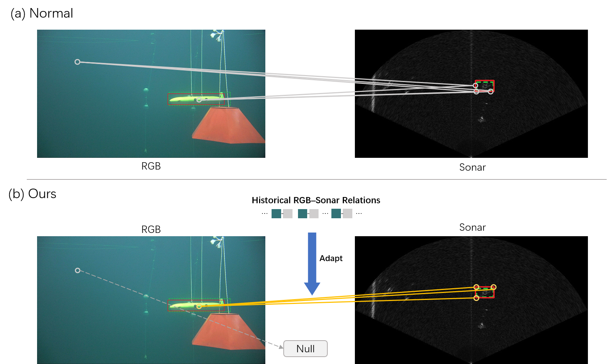
   
  <b>Figure 1.</b> History-conditioned partial correspondence for non-registered RGB--sonar tracking. (a) Naive matching forces every optical query to attend to sonar tokens, injecting spurious background echoes. (b) HCPC adapts a low-rank operator from reliable paired history and routes unmatched optical regions to a learnable <i>Null</i> option.

---

## 📄 Abstract

> Temporary optical blackouts caused by turbidity, illumination collapse, or transmission dropouts frequently interrupt underwater visual tracking even while imaging sonar continues observing the target. Recovering the RGB trajectory requires bridging heterogeneous sensor projections, preserving visual appearance during optical absence, and reliably re-identifying the returning target. We propose **BridgeTrack**, a causal sonar-guided visual tracking recovery framework that augments a frozen DropTrack backbone through a zero-initialized residual pathway composed of three coordinated modules. First, **History-Conditioned Partial Correspondence (HCPC)** encodes polar sonar structures, dynamically adapts a low-rank matching operator from historical RGB--sonar pairs, and introduces a learnable null option to prevent forced alignment of unmatched optical regions. Second, **Observation-Constrained Factorized State (OCFS)** decouples identity, kinematics, and modality-specific subspaces, enabling sonar cues to refine motion and spatial priors across blackouts while structurally locking the RGB-private appearance state. Third, **Relation-Conditioned Appearance Memory (RCAM)** retrieves historical RGB features via joint identity and cross-modal relation keys, refines multi-peak object queries, and enforces deferred tentative-to-trusted confirmation against distractors. On RGBS50, BridgeTrack reaches **47.84% AUC** and **79.25% first-return recovery (R1)**, surpassing DropTrack by **+6.79% AUC** and **+19.87% R1** while attaining **89.27% SR200**. Complementary RGB--thermal experiments on RGBT234 and NOT-156 further verify the modality-agnostic effectiveness of OCFS.

---

## 🏗️ Framework Overview

BridgeTrack keeps both 12-layer ViT-B DropTrack backbones and the sonar head frozen, optimizing only three lightweight 256-D recovery modules and the RGB prediction head via a zero-initialized residual pathway:

$$X_t^{\mathrm{aug}} = X_t^r + \Pi_{\mathrm{up}}\left(H_t^C - H_t^{\mathrm{raw}}\right)$$

During optical blackouts ($a_t^r = 0$), the RGB backbone, HCPC transfer, RCAM decoder, and CENTER head are bypassed completely while OCFS propagates target motion and spatial priors from sonar alone.

  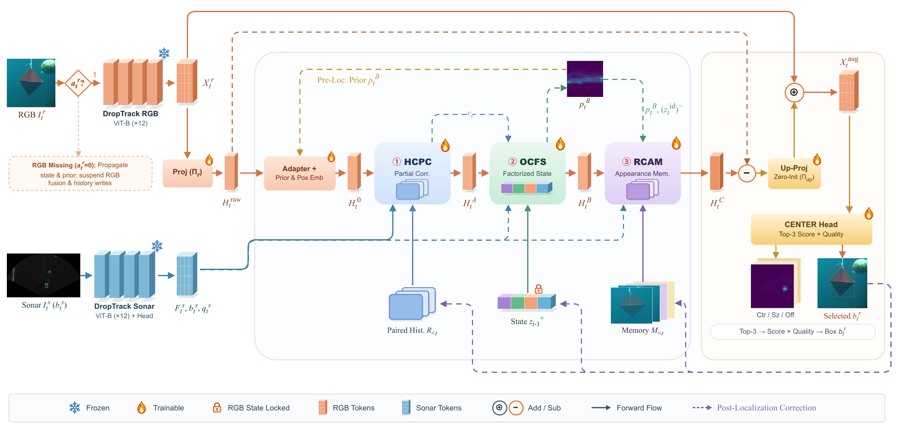
   
  <b>Figure 2.</b> Overall architecture of BridgeTrack. Pre-localization sonar encoding, state prediction, and spatial prior generation are strictly decoupled from post-localization visual correction and deferred memory updates.

 

<b>🔍 Click to expand detailed architectures of HCPC, OCFS, and RCAM</b>

 

  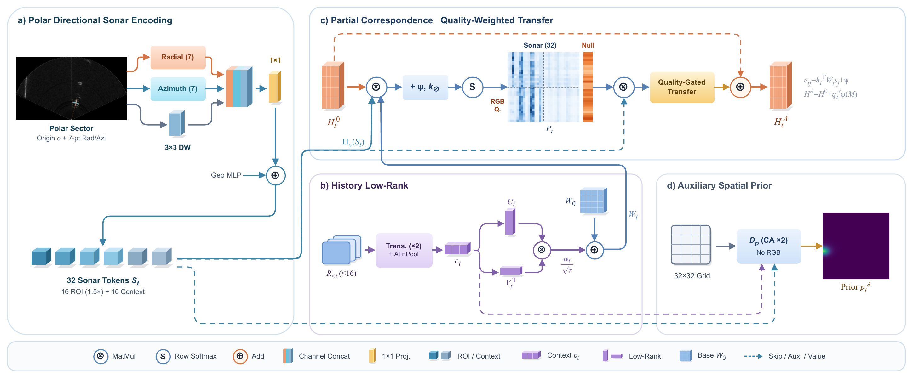 
  <b>HCPC:</b> Polar directional (7-pt radial/azimuthal + 3×3 DW) sonar encoding, history-conditioned low-rank matching operator, null-bin partial correspondence, and RGB-free auxiliary prior.

 

  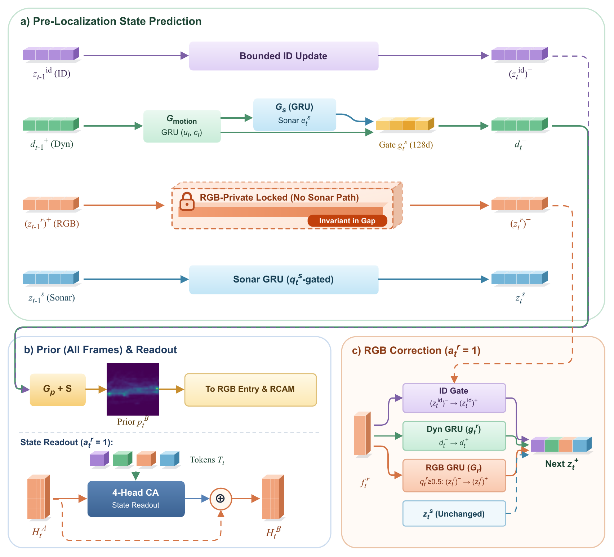 
  <b>OCFS:</b> Four 128-D factorized states with quality-gated sonar motion updates, strict structural locking of RGB-private appearance during gaps, unified 32×32 spatial prior, and post-localization visual correction.

 

  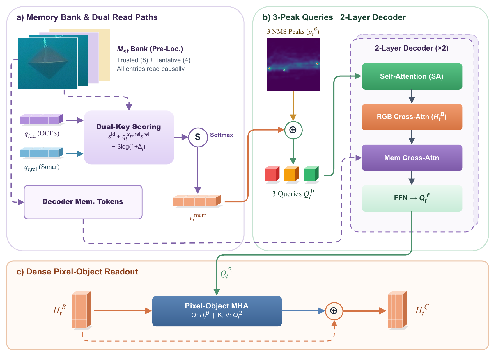 
  <b>RCAM:</b> Dual identity & cross-modal relation key retrieval over trusted/tentative banks (8 + 4 slots), 3-peak object queries refined by a 2-layer decoder, dense pixel-object readout, and deferred confirmation.

---

## 📊 Quantitative Results

### 1. Overall Continuous Tracking & Interruption Recovery on RGBS50

Selected comparison against leading visual trackers and adapted multimodal baselines (all self-evaluated under the identical RGBS50 split and interruption protocol; **bold** = best, *italic* = second-best):

| Method | Modality | AUC (%) | PR (%) | NPR (%) | R1 (%) | SR5 (%) | SR10 (%) | SR51 (%) | SR200 (%) |
| :--- | :---: | :---: | :---: | :---: | :---: | :---: | :---: | :---: | :---: |
| SDSTrack-Adapted (CVPR'24) | RGB-S | 12.27 | 11.38 | 13.72 | 6.25 | 5.00 | 7.50 | 9.65 | 15.54 |
| SMSTracker-Adapted (ICCV'25) | RGB-S | 22.68 | 23.11 | 26.39 | 21.88 | 25.00 | 37.50 | 40.76 | 44.07 |
| XTrack-Adapted (ICCV'25) | RGB-S | 24.99 | 25.54 | 28.78 | 18.75 | 25.00 | 35.00 | 46.17 | 47.66 |
| UnTrack-Adapted (CVPR'24) | RGB-S | 28.17 | 28.11 | 32.53 | 18.75 | 35.00 | 52.50 | 54.09 | 56.50 |
| KeepTrack (ICCV'21) | RGB | 33.07 | 29.04 | 38.52 | 56.25 | 47.50 | 70.00 | 74.97 | 73.01 |
| OSTrack (ECCV'22) | RGB | 36.78 | 38.68 | 42.56 | 43.75 | 55.00 | 70.00 | 81.56 | 79.91 |
| AQATrack (CVPR'24) | RGB | 38.76 | 40.43 | 44.18 | 40.63 | 77.50 | *82.50* | 83.40 | *81.70* |
| HIPTrack (CVPR'24) | RGB | 40.15 | 42.27 | 45.25 | 56.25 | 72.50 | *82.50* | *83.50* | 80.10 |
| DropTrack (CVPR'23) | RGB | *41.05* | *43.24* | *45.99* | *59.38* | *80.00* | *82.50* | *83.50* | 78.31 |
| **BridgeTrack (Ours)** | **RGB-S** | **47.84** | **49.29** | **52.57** | **79.25** | **81.51** | **84.53** | **86.97** | **89.27** |
| *Gain over DropTrack* | — | **+6.79** | **+6.05** | **+6.58** | **+19.87** | **+1.51** | **+2.03** | **+3.47** | **+10.96** |

<b>📋 Click to expand full 25-tracker comparison table on RGBS50 (Table 3 in paper)</b>

 

| Method | Group | AUC | PR | NPR | R1 | SR5 | SR10 | SR51 | SR200 |
| :--- | :---: | :---: | :---: | :---: | :---: | :---: | :---: | :---: | :---: |
| SDSTrack-Adapted | Adapted MM | 12.27 | 11.38 | 13.72 | 6.25 | 5.00 | 7.50 | 9.65 | 15.54 |
| TBSI-Adapted | Adapted MM | 13.22 | 12.12 | 15.11 | 12.50 | 15.00 | 17.50 | 22.68 | 23.58 |
| BAT-Adapted | Adapted MM | 16.76 | 12.96 | 21.59 | 15.63 | 12.50 | 17.50 | 25.79 | 32.27 |
| ViPT-Adapted | Adapted MM | 21.74 | 20.79 | 26.17 | 15.63 | 20.00 | 25.00 | 37.69 | 38.97 |
| SMSTracker-Adapted | Adapted MM | 22.68 | 23.11 | 26.39 | 21.88 | 25.00 | 37.50 | 40.76 | 44.07 |
| XTrack-Adapted | Adapted MM | 24.99 | 25.54 | 28.78 | 18.75 | 25.00 | 35.00 | 46.17 | 47.66 |
| UnTrack-Adapted | Adapted MM | 28.17 | 28.11 | 32.53 | 18.75 | 35.00 | 52.50 | 54.09 | 56.50 |
| DiMP50 | RGB | 25.71 | 20.44 | 27.63 | 28.13 | 25.00 | 40.00 | 47.80 | 49.23 |
| LiteTrack | RGB | 31.49 | 30.38 | 37.01 | 34.38 | 50.00 | 62.50 | 70.07 | 69.85 |
| MambaLCT | RGB | 32.80 | 32.55 | 38.28 | 50.00 | 65.00 | 72.50 | 71.91 | 72.04 |
| KeepTrack | RGB | 33.07 | 29.04 | 38.52 | 56.25 | 47.50 | 70.00 | 74.97 | 73.01 |
| ToMP | RGB | 33.55 | 33.54 | 38.95 | 53.13 | 60.00 | 70.00 | 72.06 | 68.05 |
| HiT | RGB | 33.62 | 33.78 | 40.67 | 28.13 | 57.50 | 67.50 | 73.49 | 67.75 |
| UETrack | RGB | 36.47 | 36.90 | 41.65 | 37.50 | 60.00 | 72.50 | 77.83 | 75.42 |
| OSTrack | RGB | 36.78 | 38.68 | 42.56 | 43.75 | 55.00 | 70.00 | 81.56 | 79.91 |
| ARTrackV2 | RGB | 36.91 | 37.58 | 40.38 | 46.88 | 65.00 | 72.50 | 76.51 | 70.69 |
| SUTrack | RGB | 37.95 | 39.45 | 43.64 | 34.38 | 62.50 | 75.00 | 76.20 | 78.44 |
| ROMTrack | RGB | 38.00 | 39.80 | 42.81 | 40.63 | 57.50 | 77.50 | 81.31 | 79.06 |
| MixFormerV2 | RGB | 38.19 | 38.92 | 42.01 | 56.25 | 65.00 | 80.00 | 80.90 | 74.75 |
| SeqTrack | RGB | 38.44 | 39.97 | 43.98 | 40.63 | 55.00 | 67.50 | 79.78 | 78.44 |
| MCITrack | RGB | 38.76 | 39.61 | 42.34 | 37.50 | 57.50 | 70.00 | 73.14 | 77.79 |
| AQATrack | RGB | 38.76 | 40.43 | 44.18 | 40.63 | 77.50 | *82.50* | 83.40 | *81.70* |
| HIPTrack | RGB | 40.15 | 42.27 | 45.25 | 56.25 | 72.50 | *82.50* | *83.50* | 80.10 |
| DropTrack | RGB | *41.05* | *43.24* | *45.99* | *59.38* | *80.00* | *82.50* | *83.50* | 78.31 |
| **BridgeTrack (Ours)** | **RGB-S** | **47.84** | **49.29** | **52.57** | **79.25** | **81.51** | **84.53** | **86.97** | **89.27** |

 

  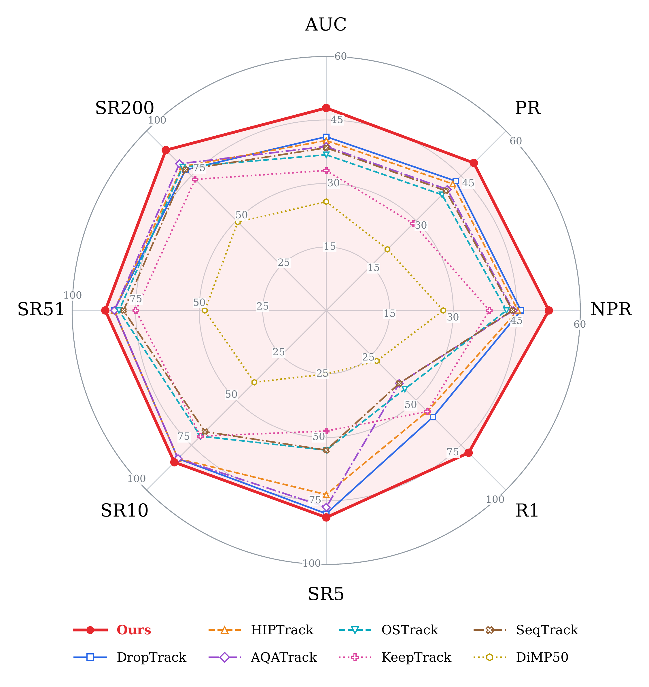
   
  <b>Figure 3.</b> Multi-metric radar profile comparing BridgeTrack (Ours) against seven representative trackers on RGBS50. Continuous metrics (AUC, PR, NPR) span 0–60%, and recovery metrics span 0–100%.

---

### 2. Fine-Grained Temporal Recovery Across Interruption Lengths

BridgeTrack confirms **40/53 events (75.5%) by frame 3** and reaches **100% cumulative confirmation** in both the 51-frame cohort (53/53 by frame 45) and the 200-frame cohort (30/30 by frame 16), whereas visual baselines leave 2–5 events permanently unconfirmed even after 200 frames.

| Cohort | Method | Gap 40 R1 | Gap 80 R1 | Gap 160 R1 | **All R1** | **All SRK** | **All Stable@10** |
| :--- | :--- | :---: | :---: | :---: | :---: | :---: | :---: |
| **51-Frame (53 events)** | DropTrack | 55.56 | 40.91 | *75.00* | 50.94 | 81.23 | 83.02 |
| | KeepTrack | *74.07* | 50.00 | *75.00* | *64.15* | 78.31 | 77.36 |
| | HIPTrack | 62.96 | 50.00 | *75.00* | 58.49 | *86.66* | *86.79* |
| | **BridgeTrack (Ours)** | **77.78** | **77.27** | **100.00** | **79.25** | **86.97** | **90.57** |
| **200-Frame (30 events)** | DropTrack | 60.00 | 38.46 | *50.00* | 50.00 | 85.00 | *83.33* |
| | ToMP | 60.00 | *53.85* | *50.00* | 56.67 | *86.73* | *83.33* |
| | HIPTrack | *73.33* | 46.15 | *50.00* | *60.00* | 86.66 | *83.33* |
| | **BridgeTrack (Ours)** | **93.33** | **69.23** | **100.00** | **83.33** | **89.27** | **96.67** |

  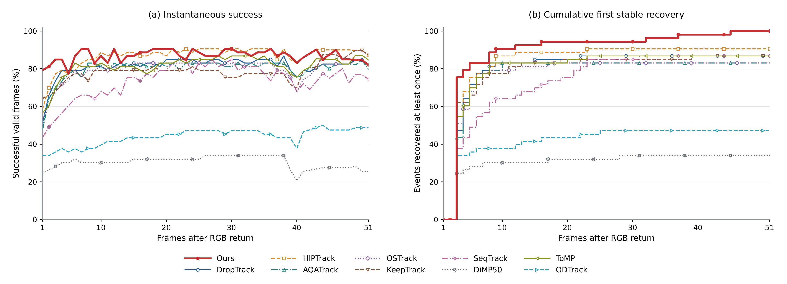
   
  <b>Figure 4.</b> Offset-resolved instantaneous success and cumulative first stable recovery over 51 returning frames (53 events).
    
  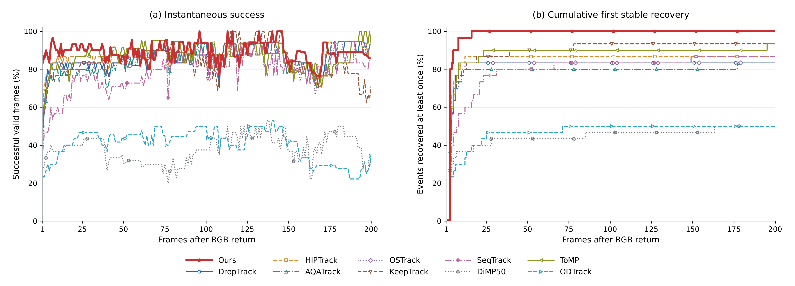
   
  <b>Figure 5.</b> Extended recovery persistence over 200 returning frames (30-event common subset). BridgeTrack reaches 100% cumulative confirmation by frame 16.

 

<b>📈 Click to expand gap-stratified 200-frame recovery curves (Gap 40 / 80 / 160)</b>

 

  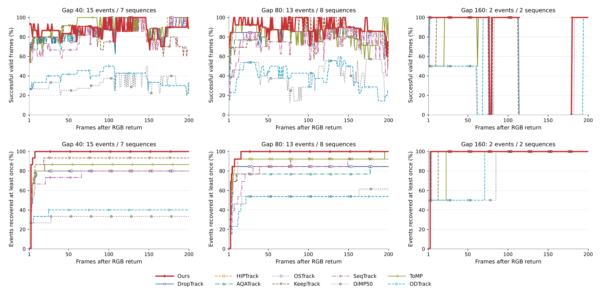
   
  <b>Figure 6.</b> 200-frame recovery curves stratified by optical blackout duration (Gap 40: 15 events, Gap 80: 13 events, Gap 160: 2 events).

---

### 3. Cross-Modal Generalization to RGB--Thermal Tracking

Without HCPC or RCAM, plugging **OCFS alone** into a controlled dual-modal DropTrack baseline yields consistent gains on both held-out RGBT234 interruption recovery (73 events) and zero-shot continuous night-time tracking on NOT-156 (50 sequences), where severe low-light underexposure acts as an implicit optical blackout:

| Model | RGBT234 Stable@5 (%) | RGBT234 Stable@10 (%) | NOT-156 AUC (%) | NOT-156 PR (%) |
| :--- | :---: | :---: | :---: | :---: |
| Dual-modal baseline | 50.68 | 54.79 | 53.44 | 67.11 |
| **+OCFS** | 50.68 | **56.16** (+1.37) | **54.12** (+0.68) | **67.99** (+0.88) |

---

## 🔬 Ablation & State Dynamics

All eight module combinations share identical frozen ViT-B backbones, training schedules, evaluation splits, and online search policies:

| Variant | HCPC (A) | OCFS (B) | RCAM (C) | R1 (%) | SR5 (%) | SR10 (%) | SR51 (%) | SR200 (%) |
| :--- | :---: | :---: | :---: | :---: | :---: | :---: | :---: | :---: |
| Baseline | | | | 59.38 | 75.83 | 79.25 | 81.35 | 82.97 |
| +A | ✓ | | | 69.71 | 78.44 | 81.47 | 83.32 | 84.86 |
| +B | | ✓ | | 66.33 | 78.22 | 81.63 | 83.60 | 85.36 |
| +C | | | ✓ | 64.35 | 77.53 | 81.05 | 83.88 | 85.99 |
| +A+B | ✓ | ✓ | | *75.67* | *80.26* | *83.26* | 85.28 | 87.25 |
| +A+C | ✓ | | ✓ | 74.88 | 80.03 | 83.05 | 85.62 | 87.70 |
| +B+C | | ✓ | ✓ | 71.70 | 79.69 | 83.00 | *85.73* | *88.01* |
| **BridgeTrack (Full)** | **✓** | **✓** | **✓** | **79.25** | **81.51** | **84.53** | **86.97** | **89.27** |

- **HCPC (+A)** drives the largest single-module jump in immediate first-return accuracy (**+10.33 pp R1**).
- **OCFS (+B)** preserves cross-gap trajectory continuity and guarantees strict structural invariance of the RGB-private appearance state.
- **RCAM (+C)** yields the strongest single-module long-horizon persistence (**+3.02 pp SR200**).

  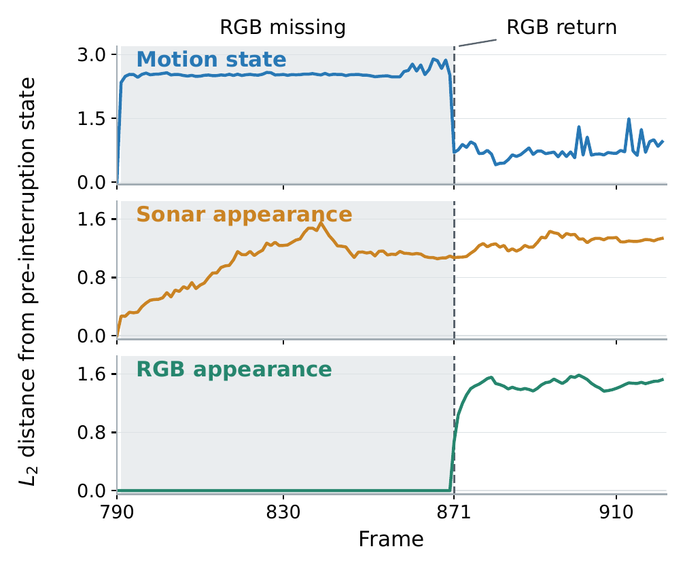
   
  <b>Figure 7.</b> OCFS state evolution across an 80-frame RGB blackout (frames 791–870) in <i>octahedron6</i>. Motion and sonar states evolve continuously while the RGB-private appearance state maintains an exact <b>0.0 L2</b> displacement until optical restoration at frame 871.

---

## 🎯 Qualitative Results

  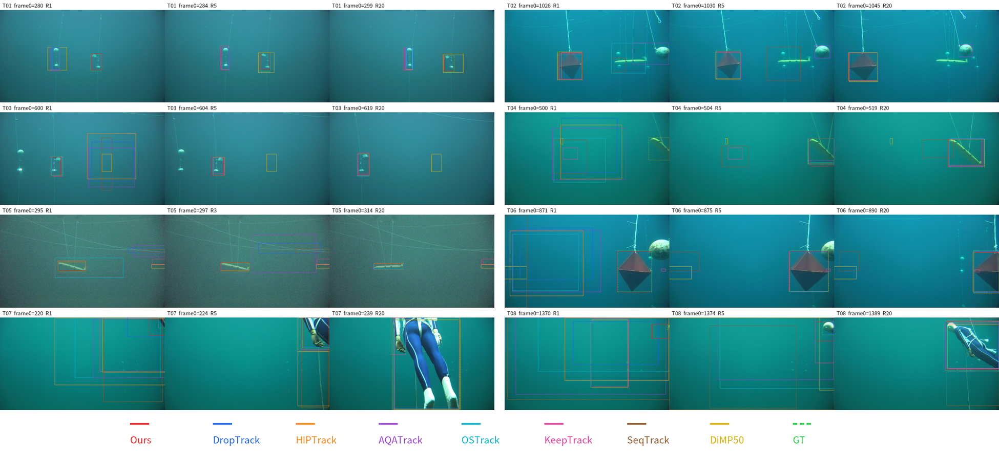
   
  <b>Figure 8.</b> Qualitative recovery trajectories across eight challenging underwater segments (T01–T08) spanning visually similar distractors (T01), turbid low-contrast water (T03, T05), large cross-gap displacement (T02, T06), and partial boundary entry (T04, T07, T08).
    
  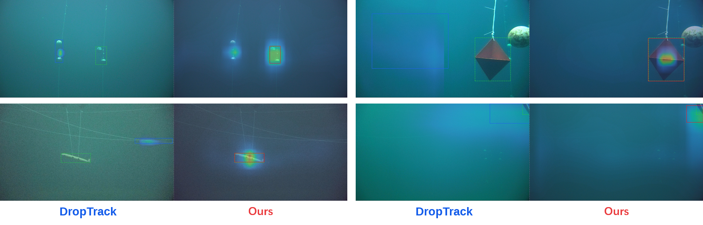
   
  <b>Figure 9.</b> Raw CENTER localization response maps comparing DropTrack and BridgeTrack (Ours) on four recovery frames, demonstrating sharpened unimodal target activation and distractor suppression directly at the feature representation level.

---

## 🙏 Acknowledgements

Our work builds upon the open-source foundation of [DropTrack (DropMAE)](https://github.com/jimmy-dq/DropMAE) and evaluates on the publicly available benchmarks **RGBS50** (SCANet), **RGBT234**, and **NOT-156**. We sincerely thank the authors of these works for making their models and benchmarks accessible to the community.

## 📬 Contact

For questions regarding the paper or upcoming release, please contact:

- **Wenji Wu**: [wuwenji@hrbeu.edu.cn](mailto:wuweji@hrbeu.edu.cn)
